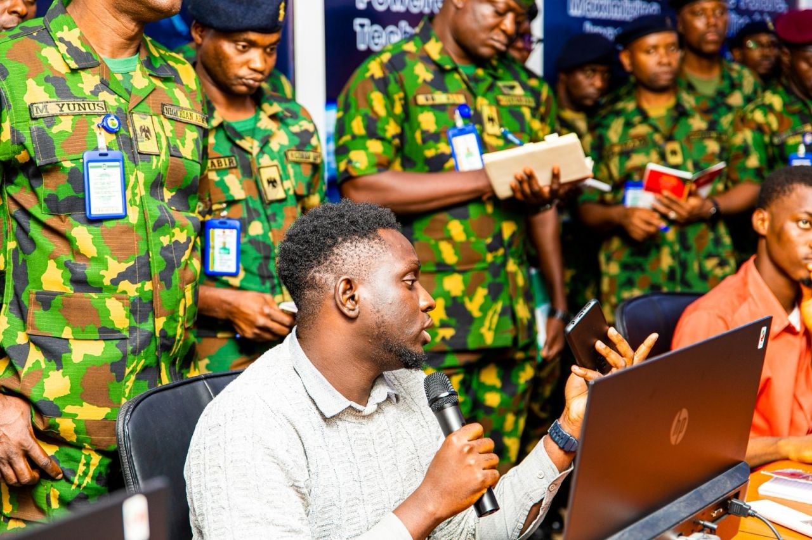
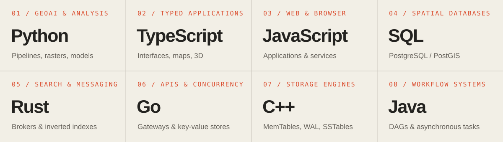
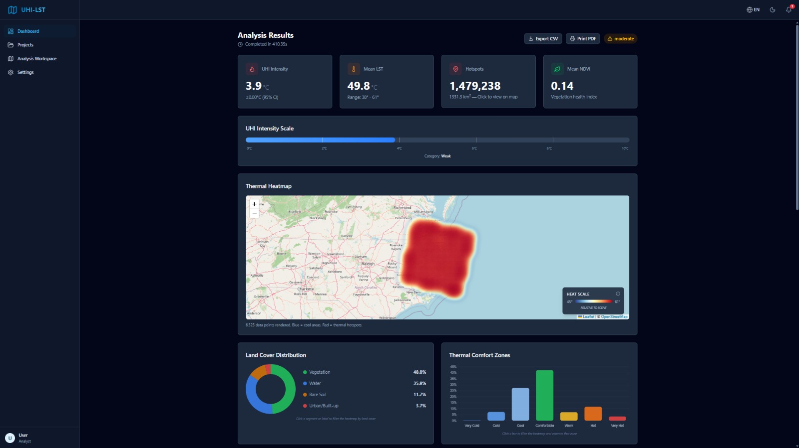
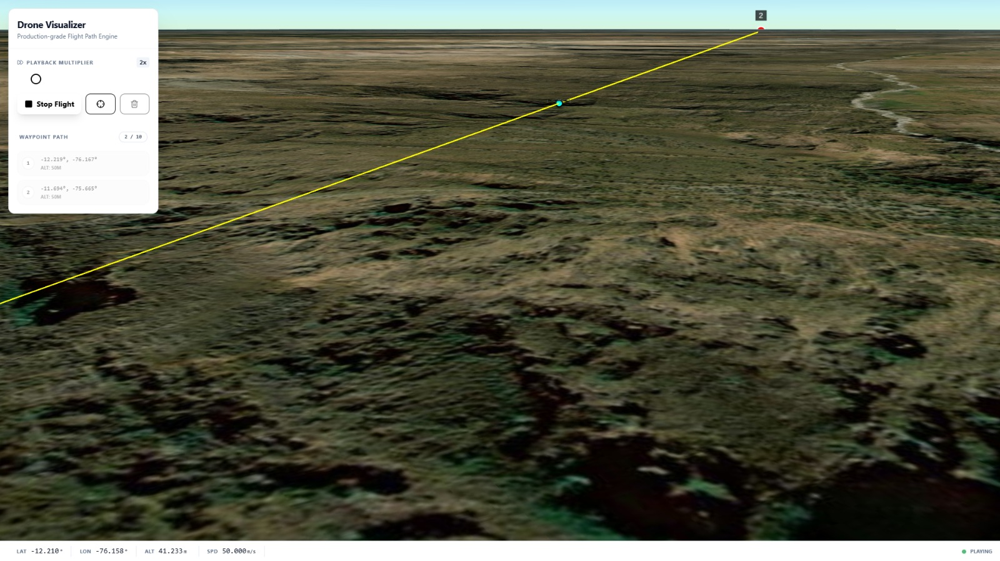
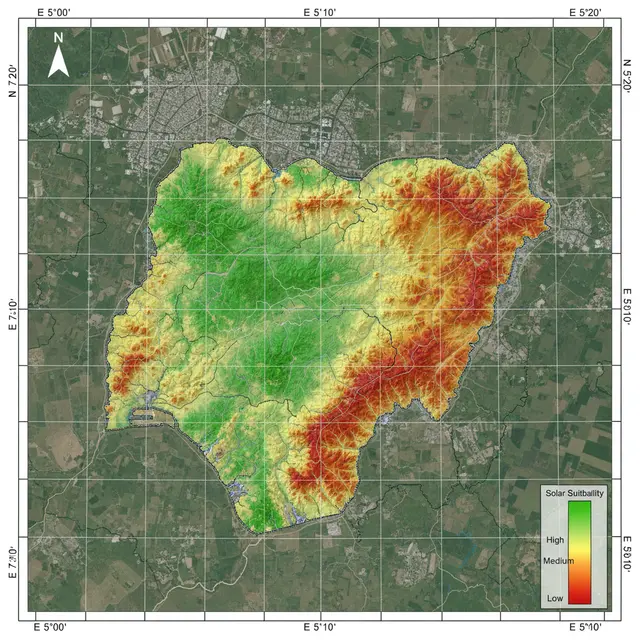

  <a href="https://www.sanusiabdulfatai.com"><strong>PORTFOLIO</strong></a> &nbsp; / &nbsp;
  <a href="#01--languages--engineering"><strong>LANGUAGES</strong></a> &nbsp; / &nbsp;
  <a href="#02--selected-work"><strong>PROJECTS</strong></a> &nbsp; / &nbsp;
  <a href="https://linkedin.com/in/abdulfatai-sanusi-gis/"><strong>LINKEDIN</strong></a> &nbsp; / &nbsp;
  <a href="mailto:work.abdulfatai@gmail.com"><strong>CONTACT</strong></a>

A live software demonstration from my professional portfolio.

## I'm Abdulfatai. I write software that understands place.

I'm a **Geospatial Software Engineer** and **Cesium Certified Developer** based in **Abuja, Nigeria**, working across satellite intelligence, enterprise GIS, GeoAI, and full-stack applications. At **Proforce Galaxies Limited**, I build geospatial software, develop GeoAI and GenAI pipelines, and automate spatial workflows for the defence, space, and satellite sectors.

My work runs from a satellite band or a field survey all the way to a database, an API, and an interface someone can actually use. That has meant mapping electricity networks, modelling solar-site suitability, analysing urban heat, and building 3D tools in the browser.

**5+ years in geospatial work. B.Tech. in Remote Sensing & GIS, FUTA. Founder of GeoIntel.**

> “GIS and Remote Sensing can solve any problem, as long as it exists on Earth.”
>
> — The line I keep coming back to.

## 01 / Languages & engineering

<picture>
  <source media="(max-width: 1000px)" srcset="./languages-mobile.svg" />
  
</picture>

**Python** is where much of my geospatial and GeoAI work happens: raster processing, spatial analysis, data pipelines, APIs, and automation. **TypeScript and JavaScript** bring that work into interactive maps and applications. **SQL with PostgreSQL/PostGIS** handles the spatial data underneath.

I also write **Rust, Go, C++, and Java**. My public systems projects cover search, messaging, storage, gateways, and workflow execution:

| Language | Where you can see it |
| :--- | :--- |
| **Python** | [UHI-LST](https://github.com/dimxxkun/UHI_LST-MODEL): Landsat processing, numerical analysis, and land-cover classification |
| **TypeScript** | [Drone Flight Path Visualizer](https://cesium-developer-cert.vercel.app/): React, CesiumJS, and CZML; [portfolio source](https://github.com/dimxxkun/sanusiabdulfatai) |
| **JavaScript** | [Notification service](https://github.com/dimxxkun/notification-service) and browser application work |
| **SQL** | PostgreSQL/PostGIS spatial data workflows, including the [customer enumeration work in my portfolio](https://www.sanusiabdulfatai.com/projects) |
| **Rust** | [Strata Queue](https://github.com/dimxxkun/strata-queue): partitioned messaging; [Vortex Search](https://github.com/dimxxkun/vortex-search): inverted indexes and BM25 ranking |
| **Go** | [Zenith Gateway](https://github.com/dimxxkun/zenith-gateway): rate limiting and circuit breakers; [Sentinel KV](https://github.com/dimxxkun/sentinel-kv): sharding, TTL, and write-ahead logging |
| **C++17** | [Hydra LSM](https://github.com/dimxxkun/hydra-lsm): MemTables, SSTables, Bloom filters, and a write-ahead log |
| **Java** | [Nexus Workflow](https://github.com/dimxxkun/nexus-workflow): DAG scheduling, asynchronous execution, and retry policies |

## 02 / Selected work

<table>
<tr>
<td width="50%" valign="top">

<h3>01 — Reading the heat of a city</h3>

<strong>UHI-LST Analysis Platform</strong>

Landsat 8/9 imagery becomes surface-temperature maps, urban heat island assessments, and ML-based land-cover analysis. An end-to-end connection between scientific processing and a usable application.

<code>Python</code> <code>NumPy</code> <code>scikit-learn</code> <code>React</code>

<a href="https://github.com/dimxxkun/UHI_LST-MODEL"><strong>Explore the code ↗</strong></a>

</td>
<td width="50%" valign="top">

<h3>02 — Planning a flight in 3D</h3>

<strong>Drone Flight Path Visualizer</strong>

A browser application for planning and animating drone missions on a photorealistic globe. Built with CesiumJS and CZML as my Cesium Certified Developer submission.

<code>TypeScript</code> <code>React</code> <code>CesiumJS</code> <code>CZML</code>

<a href="https://cesium-developer-cert.vercel.app/"><strong>Open the live application ↗</strong></a>

</td>
</tr>
</table>

### The solar study that earned an Esri Young Scholars award

**3rd Place · Esri Young Scholars Award, Nigeria · 2025**

My solar-site suitability work evaluates locations in **Akure and Ikorodu** using GIS-based multi-criteria analysis, weighted overlays, and conditional tools. It connects raster analysis to a practical energy-planning question: where should solar installations go?

**ArcGIS Pro · MCDA · Raster analysis**

[Read the study ↗](https://drive.google.com/file/d/1JZwndvvhij9jbknM61xCxnUjj23C-t9Z/view?pli=1)

 

### More work from the field and the browser

| Work | The problem and the implementation |
| :--- | :--- |
| **Electricity network assets** | Published **11kV and 33kV** network assets across **five business hubs in Osun State** through ArcGIS Enterprise Portal. |
| **Customer enumeration** | Field data and CIN collection for billing and network planning, using **Field Maps, Survey123, and PostGIS**. |
| **[Interactive 3D City Mesh](https://3dmesh.vercel.app/)** | Integrated mesh scenes with weather, flood toggles, and lighting, using **Three.js, CesiumJS, and ArcGIS**. |
| **[TaxNaija](https://tax-naija-tau.vercel.app/)** | A Nigerian tax-compliance application with calculation engines and an AI assistant, built with **React, TypeScript, Gemini, and Vercel serverless functions**. |
| **Land cover & environmental monitoring** | Supervised LULC classification in **Akure** and satellite-based oil-spill assessment in **Oyigbo, Rivers State**. |
| **Distributed data analysis** | Sales reconciliation across **eight regions**, using **Python, pandas, and a multi-agent / MapReduce architecture**. |

[View the full project collection ↗](https://www.sanusiabdulfatai.com/projects)

## 03 / The stack behind the work

| Discipline | Tools I use |
| :--- | :--- |
| **Earth observation & GIS** | ArcGIS Pro · ArcGIS Enterprise · QGIS · Google Earth Engine · ESA SNAP · ENVI · ERDAS · GDAL · GeoServer |
| **GeoAI & scientific computing** | ArcPy · GeoPandas · Rasterio · NumPy · scikit-learn · Random Forest · SVM · deep learning · Hugging Face |
| **Web maps & 3D** | CesiumJS · CZML · Three.js · Leaflet · Mapbox GL JS · OpenLayers · deck.gl · ArcGIS Maps SDK |
| **Applications & APIs** | React · Next.js · Django / GeoDjango · FastAPI · Node.js · Vite · Tailwind CSS · REST |
| **Data & delivery** | PostgreSQL · PostGIS · spatial ETL · Docker · Vercel |
| **Enterprise & field GIS** | Field Maps · Survey123 · Experience Builder · Dashboards · CityEngine |
| **Generative AI** | LLM integrations · Gemini API · GenAI-assisted geospatial workflows |

## 04 / Where I've worked

| When | Role | Organisation |
| :--- | :--- | :--- |
| **2025–present** | Geospatial Engineer & Developer | **Proforce Galaxies Limited**, Abuja |
| **2025–present** | Founder & CEO | **GeoIntel** |
| **2024–Jun 2025** | GIS Analyst | **Ibadan Electricity Distribution Company** |
| **2023–present** | Freelance GIS Consultant | **Upwork / Fiverr** |
| **2022** | GIS Intern | **Ibadan Electricity Distribution Company** |
| **2020–2022** | Geospatial Analyst | **Geotechnics Services Limited** |

**Education:** B.Tech., Remote Sensing & GIS, **Federal University of Technology, Akure** · 2018–2024 · Magna cum laude.

[More about my experience](https://www.sanusiabdulfatai.com/experience) &nbsp; / &nbsp; [Curriculum vitae](https://drive.google.com/file/d/1l_fU894tu8uIuUlSRxI8263fCre9QjrU/view?usp=sharing)

## 05 / Open source, with the receipts

**[REA](https://github.com/morluto/rea)** — contributed a [fix for trailing-slash package exports](https://github.com/morluto/rea/commit/3a25046b8c69b85c6cd11f64b2f936ad7252cc1f), including regression coverage. I also published [Windows browser reproduction results](https://github.com/morluto/rea/issues/8312#issuecomment-6878560184) to help investigate an unresolved report.

My systems repositories above are another part of the picture: a place to work on the mechanics underneath applications—storage, concurrency, messaging, search, and execution.

## 06 / Recognition, credentials & community

- **Esri Young Scholars Award, Nigeria — 3rd Place** · 2025, for solar-site suitability modelling.
- **Cesium Certified Developer** · 2026.
- **Certified Geospatial Engineer/Developer, micro1** · 2026.
- **NASA ARSET: Hyperspectral Data for Land and Coastal Systems** · 2026.

<strong>More training & continuing education</strong>

- **Esri, 2025:** Going Places with Spatial Analysis; GIS for Climate Action; Make an Impact with Modern Geo Apps; Power Data-Driven Decisions with ArcGIS Dashboards; Designing GIS Applications with Accessibility.
- **Quantic, 2025:** Decision-Making with Analytics; Business Intelligence in Action.
- **Alison, 2022–2024:** Advanced Diploma in GIS; Representing the Real World in GIS; GIS Data Quality and GPS.

[Full credentials on my portfolio](https://www.sanusiabdulfatai.com/about)

I teach GIS and remote sensing, share work through talks and workshops, and write about how geospatial systems are changing.

- **Watch:** [Geospatial FM — Power Utilities & Earth Observation Innovation](https://www.youtube.com/watch?v=G7co24iql4M)
- **Read:** [GenAI & LLMs in Geospatial Workflows](https://www.linkedin.com/posts/abdulfatai-sanusi-gis_gis-genai-llm-share-7457020407699824640-SxRm)
- **Learn with me:** [GIS and remote sensing tutorials](https://www.youtube.com/@gamingandmiscworld1411/featured)
- **Explore:** [Talks, conferences, and other media](https://www.sanusiabdulfatai.com/media)

## Away from the keyboard

**Table tennis. Football. Chess.** I follow global affairs and geospatial research, and I like having something new to get better at.

If you're working on Earth observation, GeoAI, a spatial product, or enterprise GIS, [let's talk](mailto:work.abdulfatai@gmail.com).

