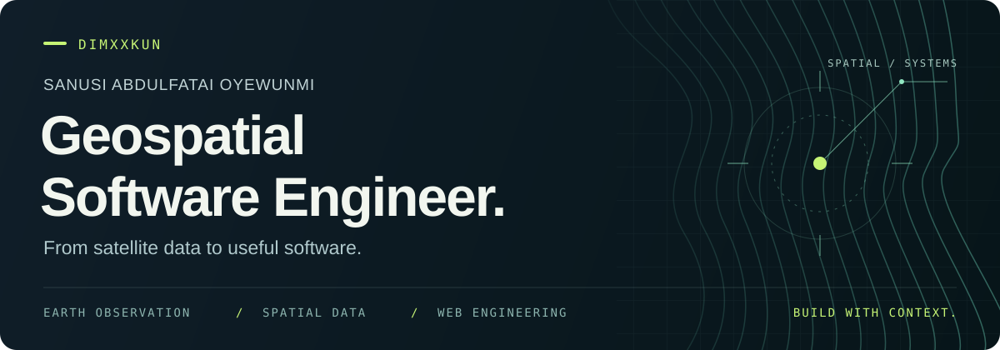

  

  <a href="https://sanusiabdulfatai.com"><strong>Portfolio ↗</strong></a>
  &nbsp;&nbsp; / &nbsp;&nbsp;
  <a href="https://linkedin.com/in/abdulfatai-sanusi-gis"><strong>LinkedIn ↗</strong></a>
  &nbsp;&nbsp; / &nbsp;&nbsp;
  <a href="mailto:work.abdulfatai@gmail.com"><strong>Let's build ↗</strong></a>

## Spatial data. Real-world software.

I'm **Sanusi Abdulfatai Oyewunmi**, a **Geospatial Software Engineer** connecting remote sensing, spatial data engineering, and full-stack development. I build the pipelines, APIs, and map interfaces that turn satellite imagery and location data into usable tools.

My background spans **5+ years** across geospatial intelligence, utilities, and environmental applications.

| Observe | Engineer | Deliver |
| :--- | :--- | :--- |
| Satellite imagery, remote sensing, and spatial analysis | Data pipelines, spatial databases, and backend APIs | Interactive maps, analytical dashboards, and GIS applications |

## Featured project · Urban Heat Island Analysis

**From Landsat imagery to surface-temperature maps and urban heat insights.**

- Processes **Landsat 8/9** bands for land surface temperature and urban heat island analysis.
- Connects a **Python / FastAPI** analysis backend to a **React / TypeScript** interface.
- Presents heatmaps, land-cover analysis, and thermal hotspot insights through **Leaflet** and interactive charts.

**[Explore the project →](https://github.com/dimxxkun/UHI_LST-MODEL)** &nbsp; · &nbsp; [Architecture & setup](https://github.com/dimxxkun/UHI_LST-MODEL#system-architecture)

## Engineering beyond the map

| Project | What it explores | Built with |
| :--- | :--- | :--- |
| **[Zenith Gateway](https://github.com/dimxxkun/zenith-gateway)** | API traffic management with rate limiting, circuit breakers, and load balancing | Go |
| **[Strata Queue](https://github.com/dimxxkun/strata-queue)** | Partitioned messaging, consumer groups, offset tracking, and dead-letter queues | Rust |

## Open-source contributions

**[REA](https://github.com/morluto/rea)** — contributed a [fix for trailing-slash package exports](https://github.com/morluto/rea/commit/3a25046b8c69b85c6cd11f64b2f936ad7252cc1f), with regression coverage. Also shared [Windows browser reproduction results](https://github.com/morluto/rea/issues/8312#issuecomment-6878560184) to help investigate an unresolved report.

## Tools I work with

| Layer | Tools |
| :--- | :--- |
| **Spatial & remote sensing** | ArcGIS Pro / Enterprise · QGIS · Google Earth Engine · GDAL |
| **Analysis & data** | Python · GeoPandas · Rasterio · NumPy · PostgreSQL / PostGIS |
| **APIs & applications** | FastAPI · Django · Node.js · React · Next.js · TypeScript |
| **Maps & delivery** | Leaflet · Mapbox GL JS · OpenLayers · Cesium · Docker |

## Recognition & learning

- **3rd Place — Esri Young Scholars Award, Nigeria** · 2025
- **NASA ARSET — Hyperspectral Data for Land and Coastal Systems** · 2026

---

**Building something spatial?** I'm open to collaboration on geospatial applications, GeoAI, and enterprise GIS.

[See my portfolio](https://sanusiabdulfatai.com) &nbsp; · &nbsp; [Get in touch](mailto:work.abdulfatai@gmail.com)
